# 🚀 Awesome Enterprise Artificial Intelligence

  

### Curated Index of Enterprise AI Platforms, Foundation Models, Multi-Agent Systems & Open-Source Infrastructure

  
  
  
  
  

---

## 📖 Introduction & Ecosystem Scope

This repository tracks notable **SaaS platforms** and **production-grade open-source projects** designed for **Enterprise Artificial Intelligence (Enterprise AI)**. These technologies empower organizations to design, deploy, evaluate, and govern AI systems at scale—spanning foundation models, agentic orchestration, high-throughput model serving, enterprise Retrieval-Augmented Generation (RAG), vector storage, and compliance guardrails.

Whether you are an enterprise architect seeking SOC2/HIPAA-compliant managed cloud platforms or an ML engineering team deploying vendor-independent, self-hosted LLM clusters, this guide provides a structured, data-driven overview of the entire enterprise AI ecosystem.

---

## 📑 Table of Contents

- [📊 Sector Overview & Market Dynamics](#-sector-overview--market-dynamics)
- [🏢 Enterprise SaaS & Hosted Platforms](#-enterprise-saas--hosted-platforms)
- [🌐 Open-Source GitHub Projects](#-open-source-github-projects)
- [🏗️ Recommended Enterprise Stack Architectures](#️-recommended-enterprise-stack-architectures)
- [🤝 How to Contribute](#-how-to-contribute)
- [##  Star History](#--star-history)
- [📜 Disclaimer](#-disclaimer)

---

## 📊 Sector Overview & Market Dynamics

- **Estimated Market Size**: The global Enterprise Artificial Intelligence market is valued at approximately **$40.4 billion in 2024** and is projected to surge to **$270+ billion by 2032**, demonstrating an exponential compound annual growth rate (**CAGR of ~34.5%**) driven by enterprise-wide generative AI automation, autonomous agent adoption, and enterprise RAG deployments.
- **Market Dynamics & Concentration**: The sector exhibits a distinct **bifurcated (barbell) market structure**:
  - **Highly Concentrated (Hyperscaler Oligopoly)** at the foundational compute and base foundation model layer, where the top hyperscalers (Microsoft Azure, Alphabet / Google Cloud, Amazon AWS) dominate large-scale model training, hardware allocation, and core API distribution.
  - **Moderately to Highly Fragmented (No Single Winner-Take-All)** at the agent orchestration, retrieval-augmented intelligence, model governance, and specialized application layer—where fierce competition among agile vendors and thriving open-source ecosystems allows enterprises to avoid single-vendor lock-in, preserve data sovereignty, and operate hybrid multi-cloud AI infrastructure.

---

## 🏢 Enterprise SaaS & Hosted Platforms

Enterprise AI SaaS platforms offer managed infrastructure, enterprise SLAs, data governance, SOC2/HIPAA compliance, and pre-integrated generative AI workflows. Below is a comprehensive breakdown, **sorted descending by company scale (valuation / market capitalization)**.

| 🏢 Platform / Vendor | 📈 Company Scale (Valuation / Revenue) | 💰 Starting Pricing | 🎁 Free Tier / Free Trial Limits | 🛠️ Core Enterprise Capabilities |
| :--- | :--- | :--- | :--- | :--- |
| **[Microsoft Azure AI](https://azure.microsoft.com/en-us/products/ai-services/)** | Market Cap: **~$3.1 Trillion** (FY24 Revenue: $245.1B) | **$0.00015 / 1k tokens** ($0.15/1M tokens for GPT-4o mini); compute starting at **$0.096/hr** (B2s VM) | **30-day free trial with $200 credits**; plus **Always Free** tier (50,000 transactions/mo for AI Search, 5,000 text records/mo for AI Language) | Azure OpenAI Service (GPT-4o), Azure AI Studio, Document Intelligence, Content Safety, private VNet isolation, and native Microsoft 365 Copilot integrations. |
| **[Google Cloud Vertex AI](https://cloud.google.com/vertex-ai)** | Market Cap: **~$2.1 Trillion** (FY24 Revenue: $350.0B) | **$0.000075 / 1k tokens** ($0.075/1M tokens for Gemini 1.5 Flash); training from **$0.49/hr** (e2-standard-4) | **90-day free trial with $300 credits**; plus Google AI Studio free quota (**15 RPM & 1,500 RPD** for Gemini Flash) | Unified ML platform, Gemini multimodal models, Model Garden (150+ models), Vertex AI Search/RAG, Grounding with Google Search, and enterprise MLOps. |
| **[AWS Bedrock](https://aws.amazon.com/bedrock/)** | Market Cap: **~$2.0 Trillion** (FY24 Revenue: $620.1B) | **$0.000035 / 1k tokens** ($0.035/1M tokens for Nova Micro; $0.80/1M tokens for Claude 3.5 Haiku) | **3 months free trial** via AWS Free Tier (1,000 input & 500 output tokens/mo on select foundation models); up to **$1,000 AWS Activate credits** for startups | Fully managed serverless foundation models (Claude 3.5, Llama 3, Mistral), Bedrock Guardrails, Knowledge Bases for RAG, and autonomous agent orchestration. |
| **[Salesforce Einstein (Agentforce)](https://www.salesforce.com/artificial-intelligence/)** | Market Cap: **~$270 Billion** (FY25 Revenue: $37.9B) | **$2.00 per conversation** for Agentforce; or **$50.00 / user / month** Sales/Service Cloud AI add-on | **30-day full feature free trial** with pre-configured Einstein generative AI workflows and CRM test data (no credit card required) | CRM-native AI platform, Agentforce autonomous agents, Einstein Copilot, Einstein Trust Layer with dynamic masking and zero data retention agreement. |
| **[IBM watsonx](https://www.ibm.com/watsonx)** | Market Cap: **~$210 Billion** (FY24 Revenue: $62.6B) | **$1,050.00 / month** for watsonx.ai Essentials tier; or **$0.15 / 1M tokens** on pay-as-you-go (Granite models) | **Free forever Lite plan** with **25,000 monthly Capacity Unit Hours (CUH)**; plus **30-day trial with $200 IBM Cloud credits** | End-to-end enterprise data and AI platform: watsonx.ai (Granite models & studio), watsonx.data (lakehouse), and watsonx.governance (lifecycle risk tracking). |
| **[Palantir AIP](https://www.palantir.com/platforms/aip/)** | Market Cap: **~$105 Billion** (FY24 Revenue: $2.87B) | **$100,000.00 / year** (~$8,333.33/mo) base platform instance via AWS/Azure Marketplace | **30-day interactive AIP Bootcamp / Sandbox pilot** with dedicated deployment engineers and pre-loaded workflows | Enterprise ontology-backed AI, real-time operational integration, strict LLM security boundaries, and mission-critical automated decision-making. |
| **[Snowflake Cortex AI](https://www.snowflake.com/en/data-cloud/cortex/)** | Market Cap: **~$55 Billion** (FY25 Revenue: $3.63B) | **$2.00 / credit** (~$2.00/warehouse-hr); LLM inference from **0.03 credits / 1M tokens** (~$0.06/1M tokens for Llama 3 8B) | **30-day free trial with $400 credits** across Snowflake data warehouse and Cortex AI functions | In-warehouse serverless LLM functions (`COMPLETE`, `EXTRACT_ANSWER`), Cortex Search (hybrid vector), and Cortex Analyst for text-to-SQL data querying. |
| **[Databricks Mosaic AI](https://www.databricks.com/product/machine-learning/mosaic-ai)** | Valuation: **~$43 Billion** (FY25 ARR: $2.6B) | **$0.07 / DBU** on serverless compute (~$1.40/cluster-hr); Model Serving starting at **$0.07 / 1M tokens** (Llama 3.1 8B) | **14-day free trial** of Databricks Platform with full Mosaic AI Model Serving, Vector Search, and feature store access | Unified data intelligence platform, custom foundation model fine-tuning, Mosaic AI Vector Search, MLflow tracking, and production LLM evaluation. |
| **[Dataiku](https://www.dataiku.com/)** | Valuation: **~$3.7 Billion** (FY24 ARR: $250M+) | **$1,500.00 / month** for Cloud Starter plan; or Pay-As-You-Go compute at **$1.40 / node-hour** | **14-day full SaaS free trial** on Dataiku Cloud; plus **Dataiku Community Edition free forever** (self-hosted, up to 3 users) | Everyday AI platform with visual RAG recipes, LLM Mesh gateway, prompt studios, enterprise model registry, and cross-cloud orchestrations. |
| **[DataRobot](https://www.datarobot.com/)** | Valuation: **~$3.0 Billion** (FY24 ARR: $200M+) | **$1,250.00 / month** ($15,000/year billed annually) for Essentials tier; or **$2.00 / GPU-hour** on cloud marketplaces | **30-day free trial** with **100 model-building credits** and pre-loaded enterprise training datasets | Enterprise AI lifecycle platform, AutoML & generative AI workbench, centralized model registry, continuous monitoring, and real-time guardrails. |
| **[C3 AI](https://c3.ai/)** | Market Cap: **~$2.8 Billion** (FY24 Revenue: $310.6M) | **$0.55 / vCPU-hour** on AWS/Azure Marketplace (~$2,500.00/mo base consumption) | **14-day interactive test-drive trial** sandbox with domain-specific pre-configured data pipelines | Turnkey enterprise AI applications for supply chain, energy, defense, and manufacturing; model-driven architecture, and deterministic enterprise RAG. |
| **[H2O.ai](https://h2o.ai/)** | Valuation: **~$1.7 Billion** (Total Funding: $251M) | **$4,166.67 / month** ($50,000/year base enterprise cluster license); core H2O-3 engine is **Free (Apache-2.0)** | **90-day free trial** on H2O AI Hybrid Cloud with managed cluster sandbox; plus **core open-source engines free forever** | H2O Enterprise AI Cloud, Driverless AI (automatic feature engineering & model selection), and h2oGPTe for private enterprise document intelligence. |

---

## 🌐 Open-Source GitHub Projects

Self-hosted, transparent, and vendor-independent technologies for running on-premise foundation models, orchestrating multi-agent systems, indexation, and LLM observability.

Each repository below features a live GitHub star badge linking directly to its stargazer community, **sorted descending by star count**.

1. **[n8n](https://github.com/n8n-io/n8n)**  — Fair-code workflow automation platform with advanced native AI agent nodes, 400+ enterprise integrations (Slack, Salesforce, Postgres, Jira), visual LangChain integration, and human-in-the-loop approvals.
2. **[Ollama](https://github.com/ollama/ollama)**  — High-performance local LLM execution engine designed for enterprise on-premise deployments; bundles model weights, configurations, and GPU acceleration into unified Modelfiles with an OpenAI-compatible REST API.
3. **[Dify](https://github.com/langgenius/dify)**  — Production-grade LLM application development platform featuring a visual prompt orchestration canvas, enterprise hybrid RAG (BM25 + vector reranking), multi-agent workflows, observability, and fine-grained RBAC.
4. **[Open WebUI](https://github.com/open-webui/open-webui)**  — Self-hosted, enterprise-ready AI interface providing an internal ChatGPT/Claude alternative; features SSO/OAuth, Granular Role-Based Access Control, encrypted conversation vaults, built-in RAG document ingestion, and multi-model routing.
5. **[LangChain](https://github.com/langchain-ai/langchain)**  — Foundational enterprise framework for orchestrating LLM-powered applications, chaining tools, memory, retrieval pipelines, and complex prompt abstractions across hundreds of enterprise data connectors.
6. **[vLLM](https://github.com/vllm-project/vllm)**  — Ultra-high-throughput and memory-efficient LLM serving engine powered by PagedAttention; standard for enterprise self-hosted inference clusters serving Llama, Mistral, and Qwen models with OpenAI-compatible endpoints.
7. **[RAGFlow](https://github.com/infiniflow/ragflow)**  — Enterprise knowledge processing and RAG engine built on DeepDoc; excels at complex corporate document parsing (financial statements, spreadsheets, PDFs with merged cells, tables, OCR) and hybrid fusion search.
8. **[AutoGen](https://github.com/microsoft/autogen)**  — Microsoft's multi-agent conversational framework enabling complex autonomous enterprise workflows through collaborative agents with sandboxed code execution, human feedback hooks, and event-driven architectures.
9. **[LiteLLM](https://github.com/BerriAI/litellm)**  — Enterprise LLM gateway and proxy supporting 100+ LLMs; provides centralized budget tracking, spend alerts, virtual API keys, automatic load balancing, fallbacks, and OpenTelemetry-compatible audit logging.
10. **[CrewAI](https://github.com/crewAIInc/crewAI)**  — Framework for orchestrating role-playing autonomous AI agents; enables engineering structured collaborative teams (e.g., researcher, planner, QA auditor) to tackle complex multi-step enterprise projects.
11. **[LlamaIndex](https://github.com/run-llama/llama_index)**  — Enterprise data framework connecting unstructured, semi-structured, and structured private data sources to LLMs; provides advanced indexing, chunking strategies, query engines, and agentic retrieval.
12. **[Milvus](https://github.com/milvus-io/milvus)**  — Distributed, cloud-native vector database engineered for enterprise-scale similarity search and AI applications handling tens of billions of embedding vectors with Kubernetes-native high availability.
13. **[LangGraph](https://github.com/langchain-ai/langgraph)**  — Graph-based orchestration library for building robust, stateful multi-actor agent systems with cyclic reasoning, persistent checkpointing, and enterprise human-in-the-loop workflows.
14. **[Qdrant](https://github.com/qdrant/qdrant)**  — High-performance vector similarity search engine written in Rust; features advanced payload-based filtering, quantization, multi-tenancy, and distributed scalability for production enterprise RAG.
15. **[Chroma](https://github.com/chroma-core/chroma)**  — Open-source embedding database designed for developer velocity; easily embeds and queries knowledge bases with native document storage, metadata filtering, and Python/TypeScript SDKs.
16. **[Semantic Kernel](https://github.com/microsoft/semantic-kernel)**  — Microsoft's enterprise AI SDK in C#, Python, and Java; integrates LLMs with conventional code, enterprise memory plugins, planning agents, and native Azure ecosystem governance.
17. **[Prefect](https://github.com/PrefectHQ/prefect)**  — Enterprise workflow orchestration platform designed for data and ML pipelines; features native dynamic task caching, failure recovery, observability, and fine-grained scheduling for automated AI workflows.
18. **[Weaviate](https://github.com/weaviate/weaviate)**  — Cloud-native vector search engine with built-in hybrid search (dense + BM25 sparse), automatic vectorization modules, multi-modal embeddings, and GraphQL querying.
19. **[Phoenix (Arize)](https://github.com/Arize-ai/phoenix)**  — AI observability and evaluation platform for LLM applications; provides OpenTelemetry tracing, automated RAG evaluation metrics, hallucination detection, and latency/cost analysis.
20. **[Triton Inference Server](https://github.com/triton-inference-server/server)**  — NVIDIA's enterprise multi-framework model serving software; standardizes model deployment across CPUs and GPUs, supporting TensorRT, PyTorch, ONNX, and vLLM with dynamic batching.
21. **[Text Generation Inference (TGI)](https://github.com/huggingface/text-generation-inference)**  — Hugging Face's production-grade toolkit for deploying large language models with Tensor Parallelism, token streaming, continuous batching, and FlashAttention.
22. **[Xinference](https://github.com/xorbitsai/inference)**  — Unified distributed model serving platform that simplifies serving LLMs, speech recognition models, and multimodal models across distributed clusters with GPU/CPU auto-allocation.
23. **[BentoML](https://github.com/bentoml/BentoML)**  — Unified framework for building reliable AI services, microservices, and multi-model composite applications with containerization and autoscaling for private enterprise clouds.
24. **[Guardrails AI](https://github.com/guardrails-ai/guardrails)**  — Enterprise validation and safety framework for LLM outputs; enforces structured schemas, PII redaction, toxic speech filters, brand tone compliance, and automated corrective actions.
25. **[Argilla](https://github.com/argilla-io/argilla)**  — Collaboration platform for data quality, human feedback (RLHF/DPO), and continuous fine-tuning dataset curation for enterprise LLM teams.
26. **[BeeAI Framework](https://github.com/i-am-bee/beeai-framework)**  — Open-source toolkit developed by IBM under Linux Foundation governance for building robust agentic workflows with granular reasoning and enterprise model independence.
27. **[Endee](https://github.com/endee-io/endee)**  — Ultra-lightweight, memory-efficient vector database engineered for low-latency semantic search and edge/on-premise RAG deployments with constrained compute resources.
28. **[Agent Stack](https://github.com/i-am-bee/beeai-platform)**  — Framework-agnostic infrastructure by IBM for rapid deployment, multi-agent protocol (A2A) networking, and production observability of AI agents.
29. **[Scale Agentex](https://github.com/scaleapi/scale-agentex)**  — Enterprise agent framework by Scale AI backed by Temporal for durable long-running workflows, asynchronous multi-agent coordination, and persistent state management.
30. **[Khiops](https://github.com/KhiopsML/khiops)**  — AutoML and automated feature engineering suite for tabular and relational enterprise databases; delivers highly interpretable predictive modeling at industrial scale.
31. **[Astromesh](https://github.com/monaccode/astromesh)**  — Multi-model agent runtime supporting six orchestration patterns, visual agent building, and cloud-native IaC deployment stacks (vLLM, pgvector, Prometheus, Grafana).

---

## 🏗️ Recommended Enterprise Stack Architectures

To build an enterprise-grade, privacy-compliant AI stack, organizations frequently combine layers as follows:

| Layer | Recommended Open-Source Components | Managed Cloud Alternative |
| :--- | :--- | :--- |
| **User & App Interface** | [Open WebUI](https://github.com/open-webui/open-webui), [Dify](https://github.com/langgenius/dify) | [Salesforce Agentforce](https://www.salesforce.com/artificial-intelligence/), [Palantir AIP](https://www.palantir.com/platforms/aip/) |
| **Agent Orchestration** | [LangGraph](https://github.com/langchain-ai/langgraph), [CrewAI](https://github.com/crewAIInc/crewAI), [AutoGen](https://github.com/microsoft/autogen) | [AWS Bedrock Agents](https://aws.amazon.com/bedrock/), [Google Vertex AI Studio](https://cloud.google.com/vertex-ai) |
| **Workflow Automation** | [n8n](https://github.com/n8n-io/n8n), [Prefect](https://github.com/PrefectHQ/prefect) | [Dataiku](https://www.dataiku.com/), [IBM watsonx.ai](https://www.ibm.com/watsonx) |
| **Document RAG & Knowledge** | [RAGFlow](https://github.com/infiniflow/ragflow), [LlamaIndex](https://github.com/run-llama/llama_index) | [Snowflake Cortex Search](https://www.snowflake.com/en/data-cloud/cortex/), [Databricks Vector Search](https://www.databricks.com/) |
| **Vector Storage** | [Milvus](https://github.com/milvus-io/milvus), [Qdrant](https://github.com/qdrant/qdrant), [Weaviate](https://github.com/weaviate/weaviate) | [Azure AI Search](https://azure.microsoft.com/en-us/products/ai-services/), [AWS OpenSearch Service](https://aws.amazon.com/) |
| **Inference Serving** | [vLLM](https://github.com/vllm-project/vllm), [Ollama](https://github.com/ollama/ollama), [Triton](https://github.com/triton-inference-server/server) | [Vertex Model Garden](https://cloud.google.com/vertex-ai), [AWS Bedrock](https://aws.amazon.com/bedrock/) |
| **Gateway & Governance** | [LiteLLM](https://github.com/BerriAI/litellm), [Guardrails AI](https://github.com/guardrails-ai/guardrails), [Phoenix](https://github.com/Arize-ai/phoenix) | [Azure AI Content Safety](https://azure.microsoft.com/), [DataRobot Registry](https://www.datarobot.com/) |

---

## 🤝 How to Contribute

Contributions are warmly welcomed! Help keep this enterprise directory fresh and exhaustive:

1. 🍴 **Fork** this repository.
2. 🌿 **Create a new branch** (`git checkout -b feature/add-enterprise-tool`).
3. 📝 **Add or update entries** in `README.md`:
   - For SaaS products: include link, description, company scale, specific starting tier pricing, and free trial / free tier limits.
   - For open-source repos: include link, shields.io star badge (`?style=social&color=white`) pointing to stargazers, and a concise enterprise-focused description. Maintain descending star order.
4. 🚀 **Commit your changes** (`git commit -m "feat: add NewTool to enterprise ecosystem"`).
5. 🔀 **Submit a Pull Request** with a brief summary of why the tool is essential for enterprise AI.

---

##  Star History

---

## 📜 Disclaimer

- This repository is a **community-curated index** created for technical reference and architectural evaluation—not a commercial endorsement.
- All enterprise AI systems deploying generative models or processing regulated data must undergo rigorous security audits and ensure compliance with GDPR, CCPA, HIPAA, ISO 42001, and the EU AI Act.
- Pricing details, feature sets, and licensing models are current as of late 2024 / early 2025 and are subject to change by respective vendors and maintainers.

---

**Built for ML Engineers, Enterprise Architects, and Technical Leaders Building Reliable AI.**

⭐ Star this repository if it helps accelerate your enterprise AI roadmap!

